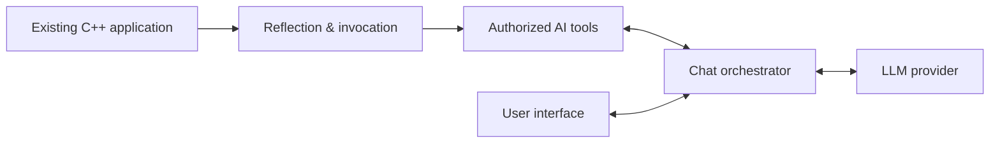

# CxxRelay

Bringing AI to existing C++ software.

CxxRelay connects established C++ applications to modern AI assistants **without replacing their business logic**. Register selected C++ capabilities, expose only approved operations, and execute AI-requested actions under host-controlled permissions.

-   :material-compass-outline: **Vision & User Story**

    ---

    Understand the motivation, user experience, and real-world scenarios.

    [Explore the vision](vision/index.md)

-   :material-code-braces: **Developer Guide**

    ---

    Build the project, register C++ methods, and run a local chat prototype.

    [Get started](developer/index.md)

-   :material-layers-outline: **Technical Reference**

    ---

    Explore the architectural boundaries, data model, security, and known limits.

    [View the reference](reference/index.md)

## One framework, three responsibilities

!!! info "Current project stage"
    CxxRelay is a **working development prototype**. Reflection, JSON, tool dispatching, chat orchestration, and local test UIs exist. The C API, MCP adapter, and reusable production GUI integration are planned.

**Suggested starting point:** [Read the user story](vision/user-story.md), then [run the mock prototype](developer/chat-prototypes.md).
