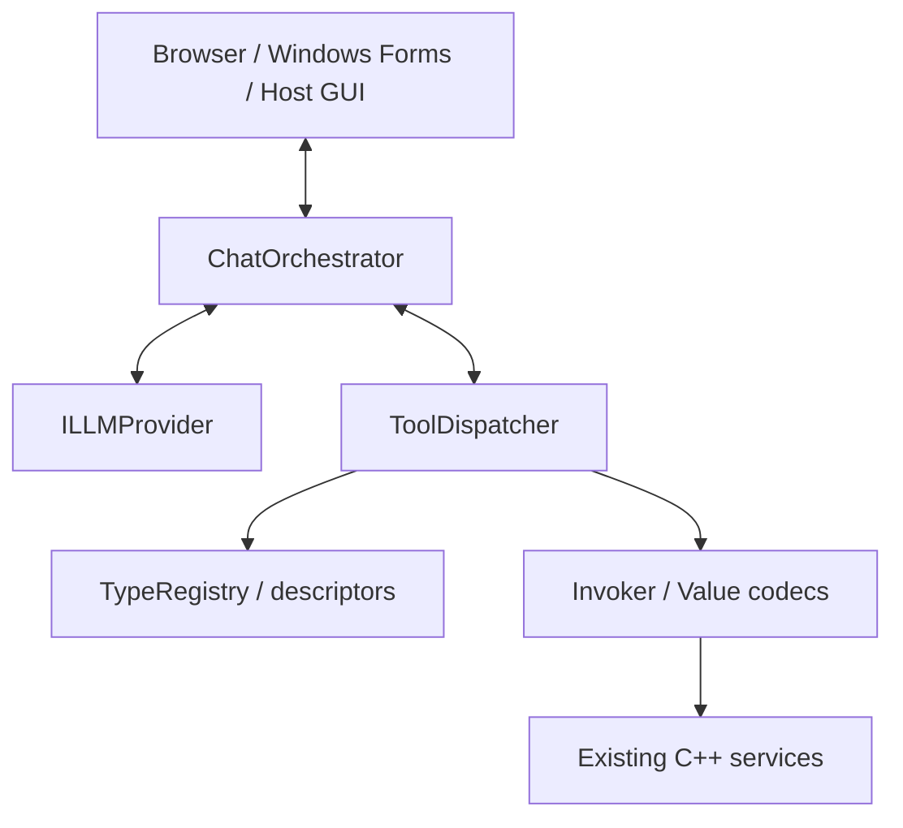

# Architecture

CxxRelay separates **describing**, **exposing**, and **executing** existing application functionality.

## Responsibilities

| Layer | Contract |
| --- | --- |
| **Reflection Core** | Describe C++ types and methods independently of AI or UI. |
| **Value & JSON** | Convert supported structured data to and from transport values. |
| **ToolDispatcher** | Expose selected operations, validate input, enforce authorization. |
| **ChatOrchestrator** | Coordinate conversations, provider calls, tool results, and approval. |
| **ILLMProvider** | Abstract the AI provider; current implementation includes OpenAI Responses API. |
| **Prototype UI & worker** | Demonstrate a working end-to-end integration via JSON-Lines. |

## Ownership boundaries

- The **host application** owns its domain rules, authenticated user context, and any database transaction boundaries.
- The **registry** owns descriptors; services are shared through explicitly bound objects.
- The **LLM** suggests calls but is never the authority for access rights or human confirmation.
- The **UI** must dispatch callbacks to its UI thread; long-running operations should not block it.

!!! note "A C interface is optional"
    The current integration calls C++ methods through the reflection layer. A stable C ABI or MCP interface can be added as an independent adapter, but neither is a finished component today.
