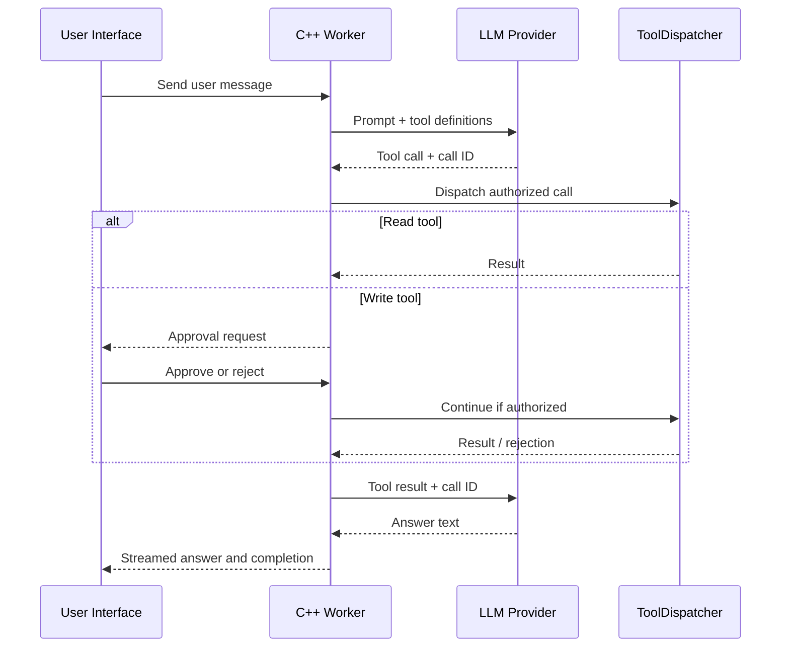

# Chat Orchestration & IPC

`ChatOrchestrator` coordinates model calls and tool results. The local prototypes place it inside a persistent C++ console worker.

## Conversation lifecycle

## Core interfaces

| Type | Role |
| --- | --- |
| `ILLMProvider` | Synchronous completion API with optional text deltas. |
| `ChatOrchestrator::send()` | Process a new turn and required tool calls. |
| `ChatOrchestrator::resume()` | Resume an awaiting write approval with matching ID. |
| `ChatOrchestrator::reset()` | Start a fresh conversation after reset, error, or abort. |
| `std::stop_token` | Cooperative cancellation. |

## Local worker protocol

The browser bridge and Windows Forms script communicate with the worker using **one JSON message per line** on standard input/output. The UI receives events such as text `delta`, requested tools, approvals, and completion messages. This is a **prototype-specific protocol**, not a published versioned IPC standard.

!!! info "Runtime limits"
    The orchestrator limits tool/model loops and message size. A synchronous C++ function cannot be forcibly stopped by `std::stop_token`; domain functions must cooperate with cancellation when needed.

The current OpenAI adapter uses the Responses API with `previous_response_id` and `store: true`. Live provider behavior requires validation with actual credentials and the target model.
