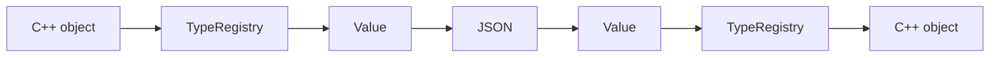

# Reflection & Value

## Data model

| Component | Purpose |
| --- | --- |
| `Value` | Owning representation of null, Boolean, signed/unsigned 64-bit numbers, double, text, arrays, and objects. |
| `TypeRegistry` | Registry of explicitly described C++ types and methods. |
| `TypeDescriptor` / `FieldDescriptor` | Names, type metadata, and registered fields. |
| `MethodDescriptor` / `ParameterDescriptor` | Method signatures, parameter ordering, and method metadata. |
| `TypeShape` | Transport-neutral description of structured types for codecs and schemas. |
| Invocation adapters | Convert `Value` arguments to typed C++ calls and results back to `Value`. |

## Typical conversion

## Design constraints

- Registration is explicit, not automatic full C++ language reflection. But with C++26 reflection there will many other possibilities.
- `Value` owns transportable data; it does **not** manage the lifetime of arbitrary live C++ objects.
- The current invoker accepts value-like arguments and `const T&`/`T&&` via decoded temporaries. Mutable `T&` parameters are not supported for transport invocation.
- Overloaded methods require explicit signature selection when their name is ambiguous.
- `const` and `noexcept` qualifiers are described, but C++ type qualifiers are **not** equivalent to application authorization policy.

!!! warning "No automatic rollback"
    If an invoked C++ method modifies state before throwing, CxxRelay does not reverse that modification. Implement transactional behavior in the host application.
