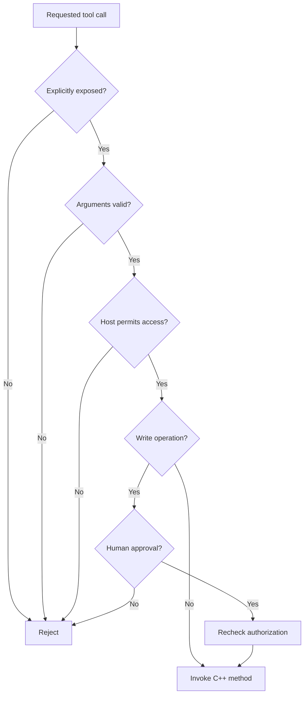

# Tool Security

**Trust boundary:** The model is an untrusted caller. `ToolDispatcher` applies host-defined rules before any registered method is executed.

## Authorization sequence

## Safeguards

| Safeguard | Current behavior |
| --- | --- |
| Tool allowlist | Only `expose()`d methods can be called. |
| Access context | Host-supplied `ToolContext` holds principal and read/write access. |
| Per-tool ACL | Optional tool-level authorization callback. |
| Write confirmation | Orchestrator pauses and requires an explicit host decision. |
| Argument checks | JSON/shape validation and typed conversion before invocation. |
| Error handling | Stable, sanitized errors are returned to external callers. |
| Audit | Optional callback, not a substitute for durable host logging. |

!!! danger "Do not implement auto-approval"
    Never derive permissions or an approval response from model text or tool arguments. Display the **exact immutable operation** to the real user and collect a trusted decision.

Production deployment also requires identity management, isolation, rate limits, transactions, privacy review, and operational monitoring from the host application.
