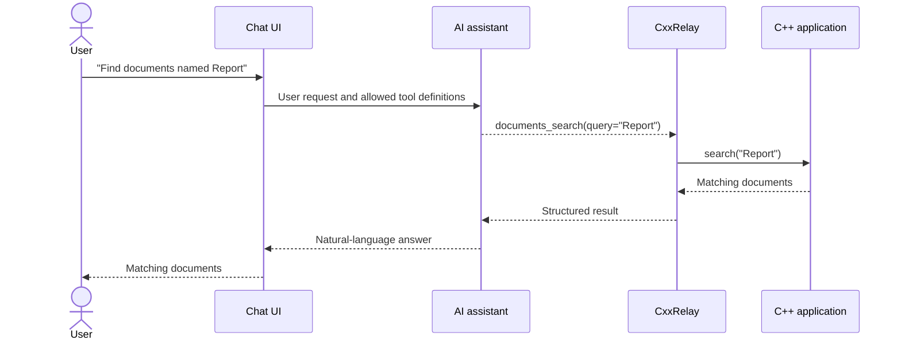

# User Story

> **As a developer maintaining an existing C++ application**, I want to expose selected objects, data, and operations to an AI assistant, so that users can work with the application through natural language without rewriting the underlying code.

## A typical interaction

### Extending the same conversation

When the user asks to rename a document, the assistant can propose the corresponding tool call. **A trusted UI requests approval before the write is executed.** Declining the request leaves the operation unexecuted.

## Acceptance criteria

- [x] Selected C++ types and methods can be registered.
- [x] Methods can be exported as explicitly named AI tools.
- [x] Arguments and results can cross a JSON boundary.
- [x] Access rights are checked before execution.
- [x] The chat workflow can pause for write approval.
- [x] Local browser and Windows Forms prototypes demonstrate the workflow.
- [ ] A production-ready, reusable GUI integration is available.
- [ ] Stable C ABI and MCP integration are provided.
- [ ] Make use of C++26 Reflection.

!!! success "Value delivered"
    Existing functionality remains the source of truth; the assistant becomes an additional way to reach it.
